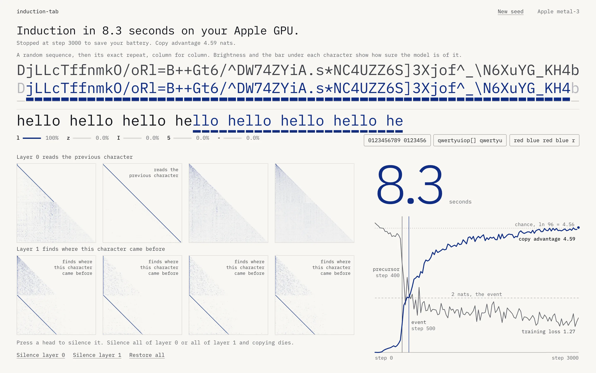
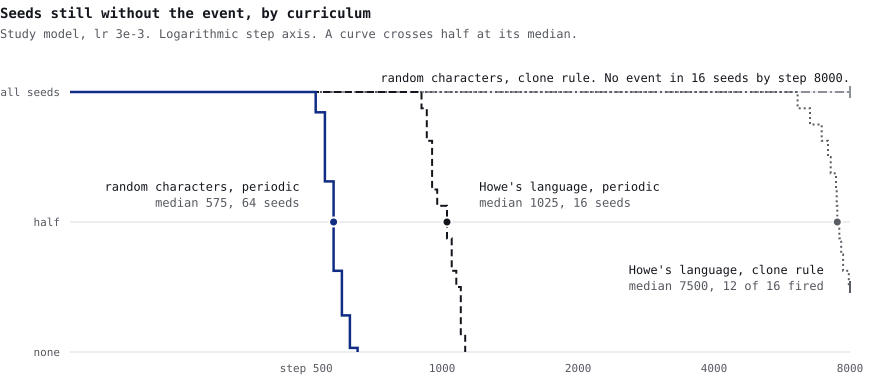
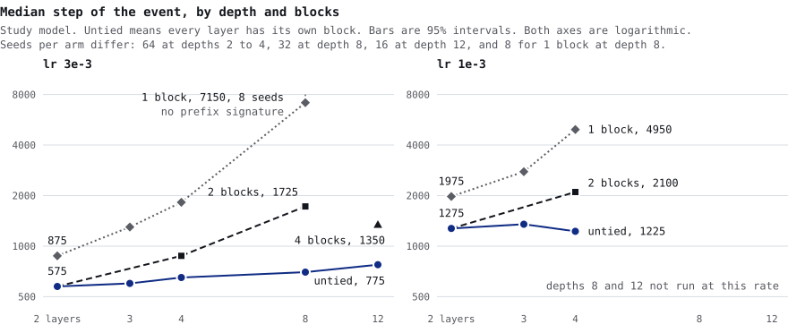

# induction-tab

Press Start and watch a transformer learn to copy on your own GPU, then type into it and silence its heads. On an M4 Pro the benchmark reaches the event in a median of 4.9 s with drawing off. With drawing on we only have readings beside another GPU job, 5.8 s at the least loaded ([details](#what-you-see)).

**[abhaymettu.github.io/induction-tab](https://abhaymettu.github.io/induction-tab/)** to run it, [the write-up](https://abhaymettu.com/research/induction-tab/) to read about it.

<picture>
  <source media="(prefers-color-scheme: dark)" srcset="docs/hero-dark.webp">
  <source media="(prefers-color-scheme: light)" srcset="docs/hero-light.webp">
  
</picture>

<sub>Seed 1 after 3000 steps on an M4 Pro. Another training job was running on the same Mac during this capture, so its clock reads 7.8 s in the dark image and 8.3 s in the light one. The benchmark for this seed, with drawing off, is 5.2 s.</sub>

## What you see

The page trains a two-layer transformer while you watch, in your browser, with no ML library and nothing to install. It trains only on random characters repeating at random periods, so the one thing to learn is that characters repeat.

For the first few hundred steps the model has learned nothing. Then three things happen close together.

- **The lower row lights up.** It is the upper row again, and brightness shows how sure the model is of each character. The model has seen those characters once, in a sequence it never trained on.
- **The attention maps draw lines.** A head in layer 0 draws a line just under the diagonal, because it reads the previous character. Heads in layer 1 draw a parallel line lower down, where they find this character's earlier copy. This is the induction circuit from Olsson et al. 2022.
- **The copy advantage crosses 2 nats.** Copy advantage is the loss on the first pass through a repeated random sequence minus the loss on the second. The event is 2 nats or more on two consecutive evals, reported at the second. Gunner Howe defined it.

Type something that repeats and the model carries on, so `abcabcabcabcab` gives `cabcabc`. Press a head to silence it. Silence all of layer 0 or all of layer 1 and copying dies. A browser with no WebGPU plays a recording of a real run and answers prompts with the saved weights on the CPU.

On an M4 Pro in Chrome, with nothing else on the GPU, seeds 1 to 5 reach the event at steps 500, 475, 600, 425, and 475. That is 5.2, 4.9, 6.2, 4.4, and 4.9 s at 10.3 ms per step, a median of 4.9 s, with drawing off, because the benchmark holds the page still. A run you watch also draws. We measured the real page with drawing on, seeds 1 to 5 over 3 rounds in headless Chrome, and its clock at the event has a median of 8.7 s. Another job held the GPU during those runs, and a tight loop on the same seed beside each one took 1.4 times its benchmark. That job only adds time, so each seed's fastest round is its least loaded reading, and those have a median of 5.8 s. We can't separate the cost of drawing from that job's cost, so this is a loaded reading and not an idle one (`results/watched-m4pro.json`). Matrix multiplies take 8.44 of the 10.04 ms in a replayed step. Native PyTorch is faster on the same machine and config. MPS takes 5.5 ms per step, about 1.9 times faster than this trainer, and 8 CPU threads take 13.9 ms.

Copy advantage does not measure copying alone. The best possible first-pass loss is chance, ln 96 = 4.56 nats, and a model that expects repeats guesses wrong on characters it has not seen, so its first pass climbs above chance. On the tab's model at the event, over 64 seeds, the first pass is 5.23, the second pass is 3.01, the advantage is 2.23, and a median 30 percent of the advantage is the first pass rising above chance (`results/third-summary.json`, key `tab.atEvent`). That is why the saved run ends above ln 96. At step 3000 on seed 1 the advantage is 4.59, the first pass 4.73 and the second 0.14 (`results/saved-run.jsonl`). The event's definition stays Howe's.

## Why it is correct

The trainer is hand-written WGSL for the forward pass, the backward pass, and AdamW. Two checks compare it to PyTorch, and the negative controls test the instruments.

**Gradients match.** `npm run parity` feeds the same weights and batches to PyTorch autograd and to the trainer for 20 steps, then compares every parameter tensor, on five configurations including the tab's own. The worst per-tensor gradient relative L2 is about 1.1e-6, 1.12e-6 in the stored run, and it varies slightly between runs.

**Whole runs match.** The tab's model ran 64 seeds both ways, from the same weights on the same batches, one on Metal and the other PyTorch on a CPU. Both reach the same event step and the same anchor step on 64 of 64 seeds, compared at evals 25 steps apart. The anchor is Howe's precursor, the first eval where a first-layer head reaches a previous-token score of 0.10. The worst copy advantage difference is 6.5e-5, and 1328 of 1336 evals differ by under 1e-5 (`results/tab-native-vs-browser.json`). The study's two-layer model matches the same way on 64 of 64 seeds, worst difference 3.2e-6 across 1539 evals (`results/native-vs-browser.json`).

All 64 seeds of the tab's model fire, at a median of step 475 and a range of 400 to 700, with no stalls by step 3000.

**Negative controls show no event.** One layer has no head beneath it to read the previous character, and a model that never sees a repeat has nothing to copy. On the tab's model each ran 8 seeds for 6000 steps with zero events (`negatives` in `results/third-summary.json`). One layer peaked at 0.913 nats of copy advantage and no repeats at 0.029. The same controls on the smaller study model also had zero events, with peaks of 1.20 and 0.067 (`results/study-negatives.jsonl`).

## What the study found

The study model is smaller than the tab's, width 64 and context 64 (d=64, T=64), for cost. Most arms ran on a rented 4 vCPU cloud VM with PyTorch on CPU, and the later ones in WGSL on the M4 Pro. Arms ran 64 seeds unless noted and are written (layers, blocks), where a block is one set of weights, so (8,1) is the same block applied 8 times. The plans are in [`research/PREREG.md`](research/PREREG.md), [`research/PREREG-2.md`](research/PREREG-2.md) and [`research/PREREG-3.md`](research/PREREG-3.md). They are committed to git and not externally registered, so their dates rest on that history alone. The public history leaves out a private working log and copies of third-party papers and of Howe's per-seed results, with commit dates kept. About 70% of the first plan's 3e-3 arms had already run, unread, when it was committed. Every arm is in [`results/study-table.md`](results/study-table.md).

Departures from the plans. `research/PREREG-3.md` says it came before any of its runs, and for two files that is not so, and we left its text as it was. `results/config-a.jsonl` was committed before the plan, so the plan ran none of its five listed config A seeds, and seed 1 came earlier, under the first plan's intent. `tab-native` seeds 1 to 8 were run and committed before the plan and sit unchanged in the 64. Their `tab-browser` partners were committed too, then deleted with the plan's commit and rerun under it to log both passes. The plan's spacing test could not be read as written on 3 seeds, and those were extended afterward (below). `research/PREREG-2.md`'s addition arm, the tab's model on Howe's curriculum, ran as `tab-howe-curriculum`.

### The repeat rule is the largest contrast we can bound, in steps

<picture>
  <source media="(prefers-color-scheme: dark)" srcset="docs/survival-by-curriculum-dark.svg">
  <source media="(prefers-color-scheme: light)" srcset="docs/survival-by-curriculum-light.svg">
  
</picture>

These arms share one model and one learning rate. Random characters made periodic reach the event at a median of step 575. Howe's language, a synthetic one in which each character has a few likely successors, takes 1025 made periodic. Howe's language with Howe's clone rule takes 7500, with 12 of 16 seeds fired by step 8000. Random characters under the clone rule fired on 0 of 16 by step 8000. Periodic means every sequence tiles at a random period. The clone rule copies the start of a sequence once, at a random offset.

Howe's curriculum against random characters made periodic is a time ratio of 13.1, and that ratio mixes three things. The clone arms used pRep 0.75 and periods [4, 60), and the tiled arms pRep 1 and [4, 32). The third plan changed one factor at a time, 16 seeds a side except the 64 of the first study (`curriculum` in `results/third-summary.json`).

| Changed alone | Fixed | One side | Other side |
|---|---|---|---|
| Repeat rule | Howe's language, pRep 1, [4, 32) | tiled, 16 of 16, median 1025 | clone, 2 of 16 by step 8000 |
| Repeat rule | uniform, pRep 0.75, [4, 60) | tiled, 12 of 16, median 2275 | clone, 0 of 16 by step 8000 |
| Period range | uniform, tiled, pRep 1 | [4, 32), 64 of 64, median 575 | [4, 60), 16 of 16, median 1025 |
| Period range | Howe's language, clone, pRep 0.75 | [4, 32), 1 of 16 by step 8000 | [4, 60), 12 of 16, median 7500 |

The repeat rule is the largest single-factor contrast we can bound, at least 7.80 on Howe's language and 3.52 on uniform characters. Period range and language under the clone rule leave one side with no median, so each has a bound of only 1.07 and may be larger, and we don't rank them. The period range changes direction between rules. Under tiling, [4, 60) against [4, 32) is a ratio of 1.78 (1.61 to 1.87), and under the clone rule the shorter periods are the worse ones. These are steps. Time per step depends on model size. Training on random repeats is also not new. shaikabdul185-arch, xanderchinxyz, and gama do it too, Zucchet et al. ([2505.17863](https://arxiv.org/abs/2505.17863)) found that repetition can greatly speed up the emergence of sparse attention, in theory and on an in-context associative recall task, and Aoyama et al. ([2511.16893](https://arxiv.org/abs/2511.16893)) found that surface bigram repetition frequency and reliability strongly affect whether induction heads form. Their natural-text experiment moved the slope of the prefix score and not the emergence point, on another measure and other models, so we don't compare effect sizes.

Howe's language can also cross the event with the second pass still worse than a guess. Of the 206 events in run files that log both passes, 3 have a second pass above chance, all on Howe's language under the clone rule: 4.92 to 5.34 against chance at 4.56, with the first pass at 7.10 to 7.37. Their top prefix scores read 0.27 to 0.50. The 28 events in `results/study-curriculum.jsonl` did not log both passes, so we can't say how many of them look the same.

### Tying weights delays the event at these depths

<picture>
  <source media="(prefers-color-scheme: dark)" srcset="docs/median-by-depth-dark.svg">
  <source media="(prefers-color-scheme: light)" srcset="docs/median-by-depth-light.svg">
  
</picture>

On random-repeat data, at equal depth, tying weights delayed the event. Two estimates of the time ratio, 64 seeds per arm at depths 2, 3 and 4:

| lr | Censored log-normal fit | Ratio of Kaplan-Meier medians |
|---|---|---|
| 3e-3 | 1.55, 2.31, 3.27 | 1.52, 2.17, 2.81 |
| 1e-3 | 1.55, 2.09, 4.07 | 1.55, 2.06, 4.04 |

The plan preregistered the log-normal fit. The two disagree where a few runs stall, such as (4,1) at lr 3e-3, where 7 of 64 had no event by step 6000.

These intervals are not adjusted for multiple contrasts. We read 55 ratio intervals across the study and the third plan, 20 of them on tying. Read at a Bonferroni level of 0.05/55 per interval, the lowest bound of those 20 is 1.26, so tying stays above 1 (`results/contrast-correction.json`). The Kaplan-Meier intervals are for the median on the 25-step eval grid. In a simulation at n=64 with the (2,2) arm's median and spread, the percentile interval covered the grid median in 97.8 to 100 percent of draws, and the continuous median in 0.4 to 97.8 percent, depending on where that median falls inside a grid cell. We did not simulate the ratio intervals.

Deeper, at lr 3e-3, (8,2) against (8,8) is 2.39 by the fit and 2.46 by medians. (12,4) against (12,12) is 1.74 (1.63 to 1.87) by medians, with no crossover. We did not find this delay reported within our coverage. The closest work finds looped models earlier than a dense model, on other tasks, and we do not claim a contradiction. [2610.31421](https://arxiv.org/abs/2610.31421) applies a 4-layer block 3 times against a dense 12-layer model, the shape of (12,4), so depth does not separate that result from ours. [2610.24135](https://arxiv.org/abs/2610.24135) compares a 4-layer block applied 8 times with an untied 32-layer model, deeper than any arm here.

(8,1) is its own case. The earlier 32 seeds had no event by step 4000. Run to step 16000, 8 of 8 fire, at a median of step 7150. Its prefix score at the event stays at or below 0.089, and every other arm in every file reads at least 0.27, with a second pass of 2.89 to 3.27 at that step. So the event alone does not show an induction head there. These runs stop at the event, so this rests on one eval per run and says nothing about what forms later. This is exploratory, on 8 seeds, and we do not explain it here.

We did not separate effective step size from structure. A tied block's gradient sums across its passes, Adam rescales each parameter by its running gradient magnitude, and lowering lr from 3e-3 to 1e-3 slowed looped arms further, (4,1) from 1825 to 4950.

Untied depth is nearly free in steps. 4 layers against 2 is 1.13 at lr 3e-3 and 0.97 at lr 1e-3, and 8 against 4 is 1.09. Each step costs more, so in floating point operations 8 against 4 is 2.15.

### The precursor gap moved, and eval spacing explains part of it

Howe's fleet puts the anchor at a steady fraction of the time to the event, inside a frozen envelope of [0.735, 0.901]. Across the study's arms at depths 2 to 4 the median fraction runs from 0.727 to 0.848. The preregistered falsifier fired for three arms just under the envelope, (2,2) and (3,3) at lr 3e-3 and (2,2) at lr 1e-3.

A second plan predicted that the anchor's distance from chance caused the miss, and tested a rescaled anchor. Under that anchor (2,1) at T=64 reads 0.903 against 0.901, so the prediction failed literally on one arm (`results/anchor-summary.json`). Eval spacing explains part of the miss on (2,2) at lr 3e-3 instead. The third plan reran that arm's own seeds at 5-step evals, continuing 75 steps past the event, and voided the test unless reading those runs every 25 steps gave the study's event on every seed. As planned it could not be read on 3 seeds, 17, 23 and 51, because their runs stopped before their coarse event. The other 61 reproduce the study's event and anchor. We then extended those 3 to 400 steps past the event, which the plan did not name, and their curves match the first runs wherever the two overlap. With them, 64 of 64 seeds reproduce the study's event and 64 of 64 its anchor. The gap is 0.748 at 5-step evals against 0.727 at 25-step, the same medians as on the 61, with a paired median difference of 0.026 (`spacing` in `results/third-summary.json`). The other two arms were not rerun at 5-step evals. At T=128 and 5-step evals, 64 seeds, (2,2) reads 0.798 and (2,1) 0.862, inside the envelope.

Spacing does not explain Howe's curriculum on the small model at 0.628, or (8,2) at 0.683, and the deepest tied arms sit lower, (12,4) at 0.495 and (8,1) at 0.161. Those are still open.

### One draw, and the rest extends

Config A is Howe's own setup, on this trainer: V=2048, T=256, d=256, B=64, lr 1e-3, Howe's language and clone rule, Howe's anchor and event.

| Config A | Seeds | Event step | Anchor over event |
|---|---|---|---|
| Gunner Howe's fleet | 30 | median 6300, range 5650 to 7400 | median 0.844 |
| This trainer | 1 | 6225 | 0.847 |

The range is in Howe's arXiv text. The 6300 and the 0.844 are computed from the per-seed results in [Howe's repository](https://github.com/gunnerhowe/Research), `mem-gen-delay/analysis/out6/r2_scored.json` at commit 493c4bf. Seed 1 took 24 minutes at 232 ms per step. The bigram table differs from Howe's, because Howe's table cannot be rebuilt without PyTorch's generator. This is one seed, so it is one draw, inside Howe's reported range and near Howe's median fraction, and it says nothing about the fleet's spread. Everything else here extends Howe's event and anchor to other models and curricula.

### Two exploratory reads

In a one-block model applied twice, 2 or 3 of 4 heads score 0.10 or above as previous-token heads on pass 0 and as induction heads on pass 1, on all 8 seeds. The strongest pass 0 head scores 0.42 to 0.47, and all four heads score 0.56 to 0.66 on pass 1. This is an observation on one small model, and we claim nothing new from it. Others have looked at what tied heads do across passes at much larger scale. [2610.31421](https://arxiv.org/abs/2610.31421) section 4.1 finds high prefix-matching heads recurring across the two applications of a shared block. [2610.18127](https://arxiv.org/abs/2610.18127) Lens 4 asks whether heads change their job across iterations, reports that in looped language models they keep their roles, and notes that head multiplexing has been found in looped vision transformers. [2609.01343](https://arxiv.org/abs/2609.01343) finds the two visits of a repeated block attend to largely the same tokens, a top-8 overlap of 56 to 66% against 28 to 34% for a control. Those models are far larger than this one, and on a first pass here there is nothing beneath a head to match on, so we do not read this as conflicting with them.

In (3,3) at lr 1e-3, 8 of 64 runs put the previous-token head in layer 1. The anchor watches only layer 0 at that depth, so it never fired on those runs.

## Rerun every number

```sh
npm install
python3 -m venv .venv && .venv/bin/pip install torch numpy
```

GPU commands need Google Chrome installed. `bench`, `breakdown`, `parity`, `verify-record`, `verify-network`, and `tools/runs.mjs` use your GPU, `speed-native` times PyTorch on CPU and MPS, and `heads` trains with PyTorch on CPU. The rest read stored runs in `results/`. [`AGENTS.md`](AGENTS.md) has the layout and the traps.

| Claim | Number | Command | Output file |
|---|---|---|---|
| Seconds to the event, M4 Pro, drawing off | median 4.9 s, 10.3 ms per step | `npm run bench` | `results/bench-m4pro.txt` |
| The page's clock, drawing on, beside another GPU job | median 8.7 s, least loaded 5.8 s, 1.4 times the benchmark beside it | `node tools/watched.mjs` | `results/watched-m4pro.json` |
| Where a step goes | 8.44 of 10.04 ms in matrix multiplies | `npm run breakdown` | `results/breakdown-m4pro.txt` |
| Native speed | MPS 5.5, CPU 13.9 ms per step | `npm run speed-native` | `results/native-speed.json` |
| Gradients against PyTorch | about 1.1e-6 relative L2 at worst, 1.12e-6 in the stored run | `npm run parity` | `results/parity-apple-metal-3.json` |
| Whole runs, the tab's model | 64 of 64 seeds, worst difference 6.5e-5, 1328 of 1336 evals under 1e-5 | `npm run compare-tab` | `results/tab-native-vs-browser.json` |
| Whole runs, the study model | 64 of 64 seeds, worst difference 3.2e-6 | `npm run compare` | `results/native-vs-browser.json` |
| Tab seeds, event and stalls | 64 of 64, median 475, range 400 to 700 | `.venv/bin/python tools/analyze_third.py` | `results/third-summary.json`, `tab` |
| First and second pass at the event | 5.23, 3.01, 2.23, 30 percent | `.venv/bin/python tools/analyze_third.py` | `results/third-summary.json`, `tab.atEvent` |
| First and second pass at step 3000, saved run | 4.73, 0.14 | `node tools/runs.mjs saved-run` | `results/saved-run.jsonl` |
| Negative controls, tab's model | 0 events, peaks 0.913 and 0.029 | `.venv/bin/python tools/analyze_third.py` | `results/third-summary.json`, `negatives` |
| Negative controls, study model | 0 events, peaks 1.20 and 0.067 | `npm run read-runs` | printed, from `results/study-negatives.jsonl` |
| Tab's model on Howe's curriculum | 0 of 8 by step 8000 | `.venv/bin/python tools/analyze_third.py` | `results/third-summary.json`, `tabOnHowe` |
| Medians by curriculum and arm | 575, 1025, 7500, 7150 | `npm run study` | `results/study-table.md` |
| Tying and depth time ratios | 1.55, 2.31, 3.27, and the rest | `npm run study` | `results/study-table.md` |
| One factor at a time | 16 of 16 against 2 of 16, 1.78, and the rest | `.venv/bin/python tools/analyze_third.py` | `results/third-summary.json`, `curriculum` |
| Depth 8 with 1 block and depth 12 | 7150, 0.089, 1.74 | `npm run study` | `results/study-table.md`, last column for the prefix score |
| Gap across arms at depths 2 to 4 | 0.727 to 0.848 | `npm run study` | `results/study-summary.json` |
| Gap against spacing, same seeds | 61 as planned, 64 of 64 extended, 0.748, 0.727 | `node tools/runs.mjs fine-2-2-extra`, then `.venv/bin/python tools/analyze_third.py` | `results/fine-2-2-extra.jsonl`, `results/third-summary.json`, `spacing` |
| Tying intervals under Bonferroni, grid coverage | 55 intervals, lowest bound 1.26, 97.8 to 100 percent | `.venv/bin/python tools/analyze_contrasts.py` | `results/contrast-correction.json` |
| Second pass above chance at the event | 3 of 206, 4.92 to 5.34 | `python3 paper/numbers.py --write` | `paper/numbers.tex`, `nLang*` |
| Gap against threshold and context | 0.903, 0.798, 0.862 | `npm run anchor` | `results/anchor-summary.json` |
| Config A | event 6225, fraction 0.847 | `npm run read-runs` | printed, from `results/config-a.jsonl` |
| Heads scoring on both passes | 2 or 3 of 4, 8 seeds | `npm run heads` | `results/heads-looped-2-1.json` |
| Any run on this list, by name | | `node tools/runs.mjs <name>`, and `node tools/runs.mjs list` shows them | `results/<name>.jsonl` |
| Nothing leaves the page's host | every request same host | `node tools/verify-network.mjs` | printed |
| Anchor misses at (3,3) | 8 of 64 | `npm run read-runs` | printed, from `results/study-lr1e-3.jsonl` |
| Record row | 4.90 s, drawing off | `npm run verify-record -- records/m4pro-chrome.json` | `records.json` |
| Figures | | `npm run figures` | `docs/*.svg` |

The stored runs came from these commands. Each row of a run file carries its config, and both trainers skip seeds their output file already holds.

```sh
# Native PyTorch on CPU
.venv/bin/python ref/train.py --cfg @configs/search/study-negatives.json --seeds 1-8 --budget 6000 --curves --jobs 4 --out fresh-negatives.jsonl
.venv/bin/python ref/train.py --cfg @configs/search/study-lr3e-3.json --seeds 1-64 --budget 6000 --curves --jobs 4 --out fresh-lr3e-3.jsonl
.venv/bin/python ref/train.py --cfg @configs/search/study-lr1e-3.json --seeds 1-64 --budget 8000 --curves --jobs 4 --out fresh-lr1e-3.jsonl
.venv/bin/python ref/train.py --cfg @configs/search/study-deep.json --seeds 1-32 --budget 4000 --curves --jobs 4 --out fresh-deep.jsonl
.venv/bin/python ref/train.py --cfg @configs/search/study-curriculum.json --seeds 1-16 --budget 8000 --curves --jobs 4 --out fresh-curriculum.jsonl

# WGSL on your GPU, with the config read from a stored file's first row by jq
node tools/dynamics.mjs "$(head -1 results/browser-2-2.jsonl | jq -c .cfg)" 1-64 6000 fresh-browser.jsonl
node tools/dynamics.mjs "$(head -1 results/p2-T64-L2-u2.jsonl | jq -c .cfg)" 101-164 6000 fresh-p2.jsonl

# The third plan's runs and the later arms, by name, on your GPU. Finished seeds are skipped.
node tools/runs.mjs list
node tools/runs.mjs tab-browser

# More config A seeds, appended to results/config-a.jsonl
SEEDS=2-30 npm run config-a
```

## Add a record to the table

1. Close anything else using the GPU, because timing measured beside other GPU work reads high.
2. Open the page, finish a run, and press **Run the benchmark**. It trains seeds 1 to 5 with the page held still and shows a log.
3. Press **Copy log**, press **Open a prefilled GitHub issue**, and paste the log below the marked line.
4. A maintainer saves the log as `records/<gpu>-<browser>.json` and runs `npm run verify-record -- records/<gpu>-<browser>.json`. It rejects the log unless the config hash matches `configs/tab.json`, the log's curve gives its event steps, the wall times agree with the step rate, and a rerun of each seed lands within 100 steps.
5. On `ACCEPT`, the maintainer adds one row to `records.json`. If the tool says the wall times are unconfirmed, because the rerun used another adapter class, the row's `adapter` text says so.

## What is not verified

- **Other browsers and GPUs.** Safari, Firefox, real phones, and non-Apple GPUs have not been measured. Only an M4 Pro and SwiftShader have, so this repo makes no claim about an ordinary laptop. One automated Safari check timed out in a background tab (`tools/safari.mjs`).
- **The clock while you watch.** The 4.9 s comes from the benchmark, which holds the page still and draws nothing. Our readings with drawing on, 8.7 s and 5.8 s at the least loaded, came from headless Chrome with another job on the GPU. We have no timing of the drawing page on an idle GPU, so the cost of drawing is unmeasured.
- **How often a seed stalls.** All 64 seeds fire on the tab's model on an M4 Pro, which does not rule out a rare stall. The small model does stall. At width 64 and context 128, 5 of 64 and 2 of 64 seeds had no event by step 6000. The page says so when this happens and offers a new seed.
- **Novelty.** "Not found" means not found within the searches logged in [`research/NOVELTY-2.md`](research/NOVELTY-2.md). The two closest demos are low visibility and turned up late, so others may exist.

## What did not work

- **Howe's curriculum at this size.** The tab's own model on Howe's language and clone rule fired on 0 of 8 seeds by step 8000, where the tab's own curriculum fires by step 700 on all 64. We stopped at 8000, so this does not say it never would. On the study model it does fire, late, at 7500 against 575.
- **"The first we could find."** An early draft claimed this. A second search found TheoremPath's lab and gama, so the claim is gone.
- **The second plan's explanation of the gap.** Distance from chance did not explain the first plan's miss, and the rescaled anchor missed on one arm of its own.

## Credits

Other browser demos train induction heads live, including TheoremPath's lab and gama's Induction, both on the CPU or without a stated GPU backend. This one runs on the viewer's GPU in hand-written WGSL, keeps MLPs and LayerNorm, and streams previous-token and induction scores with head ablation on one page. We did not find that combination within our search coverage.

- Gunner Howe wrote [arXiv 2609.19000](https://arxiv.org/abs/2609.19000), the source of the 2-nat event, the 0.10 anchor, the anchor's fraction and envelope, and the transition. Gunner Howe and Vin Howe are different people.
- Zucchet et al. wrote [arXiv 2505.17863](https://arxiv.org/abs/2505.17863), which found that repetition can greatly speed up the emergence of sparse attention.
- Vin Howe made [Sequence Toy](https://sequence.toys) and [Piston](https://github.com/vinhowe/piston), which train sequence models in the browser on WebGPU.
- Olsson et al. 2022 described the circuit and defined the head scores, prefix matching and previous token attention, on repeated random tokens, in [In-context Learning and Induction Heads](https://transformer-circuits.pub/2022/in-context-learning-and-induction-heads/index.html).
- Reddy ([2312.03002](https://arxiv.org/abs/2312.03002)), Singh et al. ([2404.07129](https://arxiv.org/abs/2404.07129)) and Aoyama et al. ([2511.16893](https://arxiv.org/abs/2511.16893)) studied what sets the formation of induction heads, on other setups.
- [TheoremPath Induction Heads Lab](https://theorempath.com/demo/induction-heads-lab) trains a two-layer model in the browser with head ablation.
- [gama](https://github.com/pariharshyamu/gama) by pariharshyamu trains and draws its Induction model live.
- [TabGPT](https://github.com/jbingen/tabgpt) and [webgpu-llm](https://github.com/toprakdeviren/webgpu-llm) write their training kernels by hand in WGSL.
- [Little Language Machine](https://arxiv.org/abs/2601.21631) trains a small transformer client-side.
- [shaikabdul185-arch](https://github.com/shaikabdul185-arch/induction-heads-from-scratch) and [xanderchinxyz](https://github.com/xanderchinxyz/forming-induction-heads) did earlier hobby work on random repeats.

MIT, see [LICENSE](LICENSE). `research/upstream/emergence_watch` keeps its own license. IBM Plex Mono in `assets/fonts` is under the SIL Open Font License, see [`assets/fonts/LICENSE.txt`](assets/fonts/LICENSE.txt).
